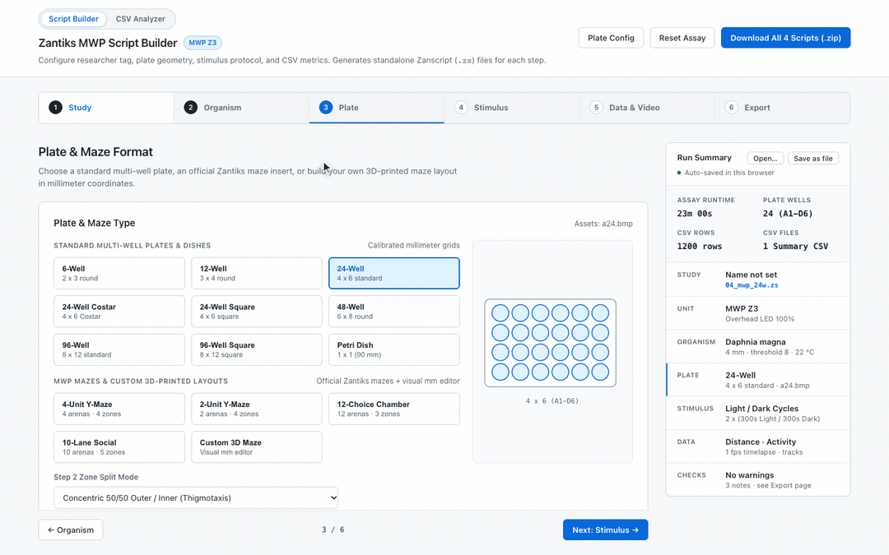
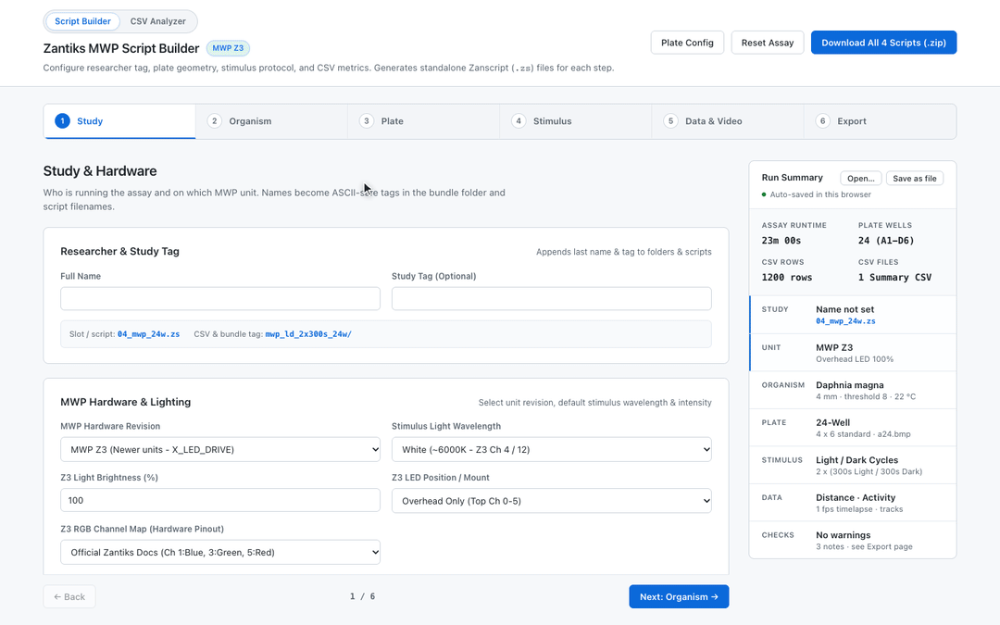

# Zanscript-Builder

**Zanscript-Builder** (*Zantiks MWP Script Builder & CSV Analyzer*) is a standalone, zero-dependency browser suite for designing behavioral tracking experiments and analyzing exported CSV data on **Zantiks MWP** systems (**MWP Z3** and **MWP Z2 / Z2S**). **Script Builder** (`zantiks_script_generator.html`) generates ready-to-compile **Zanscript (`.zs`)** files for camera calibration, multi-well plate arena/zone asset creation, tracking parameter verification, and full stimulus-driven assays; the companion **CSV Analyzer** (`zantiks_csv_analyzer.html`) provides closed-loop 10-second QC, interactive plate-map treatment grouping, pure-SVG charting, and one-click GraphPad Prism / Python exports—completely offline.

**Live Web Builder:** [https://tigerqu.github.io/Zanscript-Builder/](https://tigerqu.github.io/Zanscript-Builder/) · **Live CSV Analyzer:** [https://tigerqu.github.io/Zanscript-Builder/zantiks_csv_analyzer.html](https://tigerqu.github.io/Zanscript-Builder/zantiks_csv_analyzer.html)

> [!IMPORTANT]
> **Unofficial Community Tool — Use at Your Own Risk**
> *Zanscript-Builder* is an independent open-source project and is **not affiliated with, endorsed by, or supported by Zantiks Ltd.** Generated `.zs` scripts are provided **"AS IS"** without warranty of any kind, and the authors assume **no liability** for any potential hardware damage, data loss, or experimental issues. Always inspect generated code, verify physical hardware connections, and test new protocols on an empty plate before running live assays. See [Disclaimer & Hardware Safety](#disclaimer--hardware-safety) below.

---

## Visual Walkthrough

### 1. Step-by-Step Experiment Configuration
Walk through Study, Organism, Plate, Stimulus, and Data & Video pages while the **Run Summary** sidebar tracks total runtime, well count, and CSV outputs in real time:


### 2. True-Scale Plate Preview & Millimeter Calibration
Preview round, square, and Petri dish geometries at true millimeter scale, fine-tune well offsets inline with one-click **Auto 50% Inner Zone**, or manage unit-wide calibration profiles in **Plate Config**:



### 3. Coordinated 4-Script Preview & One-Click `.zip` Export
Inspect syntax-highlighted Zanscripts and CSV column schemas for all four workflow steps, copy Zantiks-safe service names, or download the complete run bundle as a `.zip`:


### 4. Companion 5-Step CSV Analyzer & Closed-Loop QC
Switch seamlessly from **Script Builder** to **CSV Analyzer** in the top bar and walk through **Data → QC → Groups → Plots → Export** with 1-click anomaly exclusion, interactive plate-map painting, pure-SVG charts, and GraphPad Prism / Python exports:



---

## Key Features

- **Zero-Install & Offline Ready**: Runs directly in any modern browser over `https://` or local `file://` with no local server, build step, or internet connection required—ideal for dedicated lab computers connected to a Zantiks unit.
- **Complete 4-Step Zantiks Workflow**: Generates standalone `.zs` scripts for every stage of an MWP experiment, viewable individually with syntax highlighting or downloadable together as a `.zip` bundle (including a run sheet `README_STEPS.txt`) via an embedded pure-JavaScript ZIP builder.
- **9 Plate & Dish Formats + 4 Official Mazes + Custom 3D-Printed Maze Editor**: Supports 6-, 12-, 24- (standard, Costar, and square), 48-, and 96-well (round and square) plates plus 90 mm Petri dishes, **4 official Zantiks MWP mazes** (`4-Unit Y-Maze`, `2-Unit Y-Maze`, `12-Choice Chamber`, `10-Lane Social`), and a visual **Custom 3D-Printed Maze Editor** (`127.8 × 85.5 mm` SBS canvas with empty-maze photo overlay, `RECTANGLE`/`DISC`/`SQUARE`/`TRIANGLE` drag-and-rotate, `Tile 2×2` arraying, and `Z1–Z8` multi-zone CSV logging).
- **Visual Plate Calibration & Shared Config**: Fine-tune `X_OFFSET`, `Y_OFFSET`, `COL_STEP`, `ROW_STEP`, `RADIUS` / `SIDE LENGTH`, and `INNER_ZONE` inline or across all formats in the **Plate Config** modal, with one-click **Auto 50% Inner Zone** calculation ($r_{\text{inner}} = r / \sqrt{2}$) for thigmotaxis assays.
- **10 Built-in Stimulus Protocols**: Configure constant baseline tracking, alternating Light/Dark cycles, Light-Off startle pulses, Light-On flashes (down to **50 ms / `0.05 s`** + **`2 / 5 / 10 Hz` strobe bursts**), stepper-motor Vibration startle taps (`U0`–`U3`), **Acoustic Startle** (`LOAD(AUDIO_FILE, ...)` built-in sound card), **Prepulse Inhibition (PPI)** (`ZCOMMAND` weak prepulse + ISI + strong pulse with alternating Pulse-Alone / PPI trials), multi-day Circadian `L:D` cycles (with optional **Z3 Dawn/Dusk PWM ramp**, Gamma 2.2 or Linear), **Temperature Step / Ramp** curves (`SET(THERMOSTAT, ...)`), or the advanced **AE/Premiere-style 13-Track Multi-Track Timeline** (independent Overhead `TOP` and Underneath `BOT` LED tracks with **custom 12-bit PWM curves**—Linear, Gamma 2.2 perceptual dawn/dusk, Ease-Out, S-Curve, Sine Pulse, or interactive **Custom Keyframe** drawing with 4–24 configurable steps and inline clip envelopes—plus **`2 / 5 / 10 Hz` strobe bursts**, `Temp °C`, `Vib Tap`, and `Audio` compiled automatically into flicker-free Zanscript time slices).
- **Independent Overhead & Underneath Multi-Wavelength LED Control**: Select global **Z3 LED Position / Mount** (`Overhead Only (Top Ch 0-5)`, `Underneath Only (Bottom Ch 8-13)`, or `Both Overhead + Underneath`) across **White (~6000K, Ch 4 / 12)**, **Blue (470 nm, Ch 1 / 9)**, **Green (530 nm, Ch 3 / 11)**, **Red (625 nm, Ch 5 / 13)**, and **UV (365 nm, Ch 0 / 8)** on **MWP Z3** (`X_LED_DRIVE` PWM `0–4095` paired with `LIGHTS(LIGHT13–16, ON/OFF)` RGB/UV port gates and selectable `DOCS` vs. `GRB_SHIFT` hardware batch pinout), or orchestrate Overhead (`Ch 0,1,3,4,5`) and toggleable `Bottom LEDs (Ch 8-13)` (`Ch 8,9,11,12,13`) independently in the Multi-Track Timeline—with automatic visible-channel zeroing while preserving **850 nm IR** tracking (`Ch 2` / `Ch 10`), plus `GPO6–8` RGB actions on **MWP Z2 / Z2S**.
- **Sequence Preview (Planar Light & Assay Simulator)**: Preview any of the 10 stimulus protocols (acclimation + assay) in real time in the standalone **Sequence Preview** card via a flat **Chamber · side view** (`TOP` / `BOT` wavelength bars, directional light washes, `IR 850nm ON (Ch 2/10)` badge, thermostat `°C`, stepper vibration tap, and audio cue status) paired with a **Plate · top view** SVG of blended multi-well or maze illumination—complete with **Play / Pause**, `0s` reset, `1x` / `5x` / `20x` / `60x` playback speeds, synced Multi-Track Timeline playhead & ruler scrubbing, and live `X_LED_DRIVE` PWM / `ZCOMMAND` / `AUDIO_FILE` / `THERMOSTAT` readouts.
- **Curated Organism Presets**: Instant tracking and temperature defaults for *Daphnia magna*, *Drosophila* (Adult), *C. elegans*, *Planaria*, and *Zebrafish Larvae*, plus full manual customization.
- **Composable CSV Metrics, Multi-Zone Mazes & Multi-Stream Video**: Combine centroid distance (`DIST_*`), pixel motility (`MSD_*`), zone summaries (`ZD_*`, `ZC_*`, `ZT_*` supporting Concentric 50/50, Top/Bottom & Left/Right 50/50 split-half bitmaps, and **Z1–Z8 multi-zone mazes**), event-level **Zone Entry/Exit Logs** (`LOAD(ZONECHANGES,"ON")` on a clean multi-stream `_ZCHANGE` CSV), and optional per-frame raw millimeter coordinates (`_XY` CSV), alongside timelapse (`1 fps`, `0.2 fps`), `30 fps`, or **Dual-Stream `30 fps + 1 fps`** (`VIDEO_STREAM 0 & 1`) video, configurable track trace length (`X_TRACKTIME`), selectable heatmap palettes (`COLOURMAP` `0–3`: Default / Inferno / Plasma / Viridis), and start/end `PICTURE(...)` still photos.
- **Zantiks-Safe Naming**: Automatically extracts researcher surnames and sanitizes study tags into space-free ASCII identifiers accepted by the Zantiks Control Console compiler.
- **Save, Share & Reopen Experiments**: Every choice auto-saves in your browser. **Save as file** downloads the whole design as `*_experiment.json`; **Open…** loads that file — or a scripts `.zip` downloaded from the app, which now includes `experiment.json` — to restore it exactly. Plate calibration offsets always stay with your own unit.
- **Pre-flight Checks**: The Export page lists warnings and notes before you download (heater range, short pulses vs. time bin, Z3-only features on Z2 units, UV LEDs, very large video / XY files, factory plate offsets, and more), each with a button that jumps to the page where it can be fixed.
- **Companion 5-Step CSV Analyzer & Closed-Loop QC (`zantiks_csv_analyzer.html`)**: Switch seamlessly between **Script Builder** and **CSV Analyzer** via the width-aligned (`1380 px`) top-bar suite switcher. Walk through the same calm 5-step wizard (`Data` → `QC` → `Groups` → `Plots` → `Export`) with a persistent **Dataset Summary** sidebar: drop Zantiks Summary, `_ZCHANGE`, or `_XY` CSVs alongside a Builder `.zip` / `experiment.json` (or click **Use Latest Builder Config**), exclude empty/dead wells and reflection-glitch spikes in one click, paint treatment groups (`Fill by Column` / `Fill by Row` / `Toggle Exclude Brush`) on a true-scale interactive SVG plate/maze map, inspect Mean ± SEM time-series, VMR, Thigmotaxis, `% PPI`, and Y-Maze `SAB %` pure-SVG charts, and export **Prism Grouped CSV**, **Tidy Long CSV**, **Well Summary CSV**, or a ready-to-run **Python Script (`.py`)**.

---

## Repository Structure

```text
Zanscript-Builder/
├── index.html                      # Redirect entry point for GitHub Pages
├── zantiks_script_generator.html   # Script Builder app: page markup; loads css/ and js/
├── zantiks_csv_analyzer.html       # Companion 5-step CSV Analyzer app: offline QC, plate map & SVG charts
├── css/                            # Styles, one file per area:
│   ├── base.css                    #   design tokens (1380px unified layout), shared topbar & wizard shell
│   ├── components.css, stimulus.css, data.css, export.css, modal.css
│   └── analyzer.css                #   5-step CSV Analyzer wizard, plate map & chart styles
├── js/                             # App code as plain scripts, loaded in order:
│   ├── catalogs.js                 #   organisms, plates, mazes, LEDs, protocols
│   ├── maze-editor.js              #   official maze presets & 3D-printed maze SVG canvas editor
│   ├── state.js, helpers.js        #   app state, plate-config store, naming & formatting helpers
│   ├── read-config.js              #   turns the form into one config object
│   ├── generators.js               #   the .zs generators for Steps 1-4
│   ├── sampler.js, simulator.js    #   sequence preview (also contains refreshAll)
│   ├── stimulus-editor.js          #   protocol forms and the multi-track timeline editor
│   ├── timeline.js, ui-setup.js    #   timeline bar, organism / plate / modal rendering
│   ├── export-utils.js, events.js  #   code highlighting, ZIP writer, event bindings
│   ├── wizard.js                   #   step-by-step navigation and Run Summary
│   ├── experiment-io.js            #   save / open / auto-save experiments & ZIP reader
│   ├── preflight.js                #   Export-page checks
│   ├── main.js                     #   Script Builder start-up (must load last on Builder page)
│   ├── analyzer-core.js            #   CSV parser, QC engine, protocol metrics, demos & exporters
│   └── analyzer-ui.js              #   5-step CSV Analyzer wizard, plate painter, SVG charts & UI wiring
├── zantiks_plate_config.js         # External plate geometry calibration profile (mm)
├── tests/                          # Automated tests: Builder golden scripts + CSV Analyzer checks
├── package.json                    # Test tooling only (the app needs no install or build)
├── .github/workflows/tests.yml     # Runs the tests on every push and pull request
├── assets/                         # Walkthrough GIFs for documentation
├── LICENSE                         # GNU AGPLv3 License
└── README.md                       # Documentation & hardware verification matrix
```

> **Note:** When running locally, keep `css/`, `js/` and `zantiks_plate_config.js` next to `zantiks_script_generator.html` and `zantiks_csv_analyzer.html` (just clone or download the whole folder). Both pages load over `file://` with no server, build step or install.

---

## Quick Start

1. **Use online or run locally**:
   - **Online**: Open [https://tigerqu.github.io/Zanscript-Builder/](https://tigerqu.github.io/Zanscript-Builder/) in any modern browser, **or**
   - **Offline / Local**: Clone this repository and double-click `zantiks_script_generator.html`:
     ```bash
     git clone https://github.com/TigerQu/Zanscript-Builder.git
     ```
2. **Walk through the six pages** with **Next** / **Back** (or click any step in the top bar to jump straight to it):
   1. **Study** – Researcher name & study tag (optional; appends ASCII-safe tags to generated filenames and folders), MWP hardware revision (`MWP Z3` or `MWP Z2 / Z2S`), **Stimulus Light Wavelength** (`White`, `Blue`, `Green`, `Red`, `UV`), **Z3 Light Brightness (%)**, and **Z3 LED Position / Mount** (`Overhead Only (Top Ch 0-5)`, `Underneath Only (Bottom Ch 8-13)`, or `Both Overhead + Underneath`).
   2. **Organism** – Pick an organism preset, then fine-tune `TARGET_SIZE`, thresholds, `AUTOREF_TIMEOUT` and thermostat settings.
   3. **Plate** – Select the plate format (and adjust millimeter offsets if needed).
   4. **Stimulus** – Choose from 10 protocols (9 standard assays including **Acoustic Startle** and **Prepulse Inhibition (PPI)**, or open **Advanced** for the **13-track Multi-Track Timeline** combining independent Overhead `TOP` and `Bottom LEDs (Ch 8-13)` (`BOT`) LEDs with custom PWM curves and strobe bursts, `Temp °C`, `Vib Tap`, and `Audio`), then scrub or play through the entire assay in **Sequence Preview** (**Chamber · side view** & **Plate · top view**, `1x`–`60x` speed, synced playhead, and live `X_LED_DRIVE` PWM / `ZCOMMAND` / `AUDIO_FILE` / `THERMOSTAT` readout).
   5. **Data & Video** – Choose CSV metrics, recording frame rate and overlays.
   6. **Export** – Review and download the generated scripts.
   - The **Run Summary** sidebar shows every choice, the total runtime and CSV size at all times; click a row to jump back and edit it.
3. **Export your scripts** on the **Export** page:
   - Click **Download All 4 Scripts (.zip)** (also available in the top bar on every page) to get the complete experiment folder and `README_STEPS.txt`, **or**
   - Switch between tabs (**Step 1** – **Step 4**) to **Copy Script** / **Download `.zs`** individually.
   - *Tip:* Click **Copy Slot Name** (or the filename badge) to copy the `.zs`-stripped service name (e.g. `04_qu_24w`) for pasting once into Zantiks **Settings → Zanscript shortcuts (Slots 1–20)**. Rebuilding the same slot script updates it in place without re-entering Settings, while `LOGFILE(0, ...)` tags every exported CSV with full protocol details.
   - Read the **Pre-flight Checks** at the top of the page first.
4. **Keep or share the design**: it auto-saves in this browser. Use **Save as file** in the Run Summary to share it, and **Open…** to load an `experiment.json` or a downloaded scripts `.zip`.
5. **Analyze your exported CSVs**: click **CSV Analyzer** in the top-bar suite switcher (or open `zantiks_csv_analyzer.html`) and walk through its 5-step wizard (**Data** → **QC** → **Groups** → **Plots** → **Export**) while the persistent **Dataset Summary** sidebar tracks active wells, duration, groups, and QC flags—drop your `.csv` exports + Builder `.zip` / `experiment.json` (or click **Use Latest Builder Config** / pick a built-in demo), exclude flagged anomalies, paint treatment groups, inspect pure-SVG charts, and export GraphPad Prism, Tidy CSV, Well Summary CSV, or Python (`.py`) outputs.

---

## Hardware Verification Status

All generated script permutations pass automated static checks (block closure, ASCII identifier sanitization, line-length bounds, and `LOGCREATE`/`LOGAPPEND` CSV column-count parity). The table below tracks **physical on-unit testing** across experimental scenarios as validation progresses.

**Status Legend:**
- `✅ Verified` — Compiled (`Build`), executed, and confirmed CSV/asset output on physical Zantiks MWP hardware
- `⏳ Pending` — Static syntax & official reference check passed; awaiting physical on-unit test run
- `⚠️ Partial / Issue` — Known firmware or hardware revision caveat (see notes)

| Scenario / Subsystem | Target Hardware | Configuration / Scope | Static Check | On-Unit Test | Notes / Last Verified |
| :--- | :--- | :--- | :---: | :---: | :--- |
| **Step 1: Camera Calibration** | MWP Z3 / Z2 | `Calibration(0)` with black 96-well plate | ✅ Passed | ⏳ Pending | Standard Zantiks scale calibration |
| **Step 2: Round-Well Asset Builder** | MWP Z3 / Z2 | `6`, `12`, `24`, `24 Costar`, `48`, `96`-well & `90 mm` Petri (`DISC`) | ✅ Passed | ⏳ Pending | Saves `a*.bmp` & 50/50 `dz*.bmp` to `Assets` |
| **Step 2: Square-Well Asset Builder** | MWP Z3 / Z2 | `24-Well Square`, `96-Well Square` (`SQUARE`) | ✅ Passed | ⏳ Pending | Saves `a24sq.bmp` / `a96_sq.bmp` & dual zones |
| **Step 2: Official & Custom 3D Mazes** | MWP Z3 / Z2 | `4-Y`, `2-Y`, `12-Choice`, `10-Lane Social` + Custom `127.8×85.5 mm` Canvas (`Z1–Z8`) | ✅ Passed | ⏳ Pending | Emits `SET(DrawArena/DrawZone)` + `ShapeAngle` + multi-zone CSV headers |
| **PWM Smooth Ramps & Sub-Second Strobe** | MWP Z3 | NLE LED ramp (`0→100%`), Circadian Dawn/Dusk ramp, `0.05 s` flash & `2 / 5 / 10 Hz` strobe | ✅ Passed | ⏳ Pending | Uses stepped `X_LED_DRIVE` + universal `WAIT(0.05–0.25)` strobe across all 5 LEDs |
| **Step 3: Tracking Parameter Sweep** | MWP Z3 | `TARGET_SIZE` & `DETECTOR_THRESHOLD` sweep video + CSV | ✅ Passed | ⏳ Pending | Optional 1–2 min pre-assay check |
| **Baseline Tracking (`baseline`)** | MWP Z3 | Constant Light (`X_LED_DRIVE` Overhead / Underneath / Both) or IR Dark · `DIST` + `MSD` | ✅ Passed | ⏳ Pending | Continuous time-bin logging (`Ch 2/10` IR untouched) |
| **Light / Dark Cycles (`ld_transitions`)** | MWP Z3 | Alternating Light ↔ Dark cycles · `DIST` + `MSD` + `ZONES` | ✅ Passed | ⏳ Pending | Supports `Overhead Only` (`Ch 0,1,3,4,5`), `Underneath Only` (`Ch 8,9,11,12,13`), or `Both` |
| **Light-Off Startle (`light_off_startle`)** | MWP Z3 | Sub-bin (`< TIME_BIN`) & multi-bin dark pulses + ITI | ✅ Passed | ⏳ Pending | Pulse + recovery trial loop |
| **Light-On Flash (`light_on_pulse`)** | MWP Z3 | Brief bright flashes from dark baseline + ITI | ✅ Passed | ⏳ Pending | Pulse + recovery trial loop |
| **Vibration Startle (`vibration_startle`)** | MWP Z3 | Stepper motor taps (`U0`–`U3` via `ZCOMMAND`) + ITI | ✅ Passed | ⏳ Pending | Requires MWP Z3 stepper vibration stand |
| **Acoustic Startle (`acoustic_startle`)** | MWP Z3 | Built-in sound card (`LOAD(AUDIO_FILE, "tone" / "mono" / ".wav")`) + ITI | ✅ Passed | ⏳ Pending | Custom `.wav` files must be uploaded to unit `Assets` |
| **Prepulse Inhibition (`ppi`)** | MWP Z3 | Weak prepulse + ISI + strong pulse (`ZCOMMAND`), alternating Pulse-Alone / PPI | ✅ Passed | ⏳ Pending | Official `vibration_ppi.zs` stepper syntax |
| **Long-Term / Circadian (`circadian`)** | MWP Z3 | Multi-day `L:D` schedule + hourly `AUTOREFERENCE()` | ✅ Passed | ⏳ Pending | Use `0.2 fps` timelapse or `No Video` |
| **Overhead & Underneath LEDs (`ledMount`)** | MWP Z3 | `OVERHEAD` (`Ch 0,1,3,4,5`), `UNDERNEATH` (`Ch 8,9,11,12,13`), `BOTH` across 5 wavelengths | ✅ Passed | ✅ Verified | Top/Bot White (`4/12`), UV (`0/8`), & RGB verified on MWP Z3; includes `Z3 RGB Channel Map` toggle (`DOCS` `1:B,3:G,5:R` vs `GRB_SHIFT` `1:G,3:R,5:B` hardware batch) |
| **Multi-Track Timeline (`multi_phase`)** | MWP Z3 | Independent Overhead (`TOP`) + Underneath (`BOT`) LEDs + `Temp °C` + `Vib Tap` + `Audio` tracks | ✅ Passed | ✅ Verified | LED tracks verified on physical MWP Z3 (`X_LED_DRIVE` + `LIGHT13–16` gates; `Ch 2/10` IR untouched); `Vib`/`Audio` tracks static-verified |
| **Split-Half Zones & `ZONECHANGES` Events** | MWP Z3 / Z2 | `X_SECTOR_ANGLE 180.0` / square half-split bitmaps + 3-stream `_ZCHANGE` CSV | ✅ Passed | ⏳ Pending | Separates event log (stream 0), Raw XY (stream 1), and Summary CSV (stream 2) |
| **Dual-Stream Video & Still Photos** | MWP Z3 / Z2 | Simultaneous `VIDEO_STREAM 0` (30 fps) + `1` (1 fps) & `PICTURE(...)` stills | ✅ Passed | ⏳ Pending | Official `video_picture_files.zs` / `startle_response` syntax |
| **Temperature Step / Ramp (`temp_ramp`)** | MWP Z3 / Z2 | Stepped `SET(THERMOSTAT, ...)` plateaus + baseline restore | ✅ Passed | ⏳ Pending | Standard heater regulates ambient to +10 °C |
| **Dual-Stream Raw XY (`LOG_STREAM 1`)** | MWP Z3 / Z2 | Per-frame millimeter `X/Y` CSV alongside summary CSV | ✅ Passed | ⏳ Pending | `SET(LOG_PERFRAME,ON)` secondary stream |
| **Legacy GPO Lighting (`GPO6–8`)** | MWP Z2 / Z2S | Any stimulus protocol in `MWP Z2 / Z2S` hardware mode | ✅ Passed | ⏳ Pending | Community testing welcome |

> *Tested a scenario on your MWP unit? Feel free to open an Issue or Pull Request with your hardware revision (`MWP Z3` or `MWP Z2 / Z2S`), plate type, and results to update this table.*

---

## Generated 4-Step Zantiks Workflow

Each configuration produces four coordinated Zanscript files designed to be executed in order on the Zantiks Control Console:

| Step | Script / Slot Filename Pattern | Physical Setup | Purpose |
| :--- | :--- | :--- | :--- |
| **Step 1** | `01_[lastname_]cal.zs` | Black 96-well Zantiks calibration plate | Runs `Calibration(0)` once to establish camera millimeter scale. Skip if the unit is already calibrated and undisturbed. |
| **Step 2** | `02_<lastname\|mwp>_<plateShort>.zs` | **Empty** experimental plate | Draws well arenas and 50/50 outer/inner zones onto Live View and saves `<arenaBmp>.bmp` and `<zoneBmp>.bmp` into the unit's `Assets` folder (`6w`, `12w`, `24w`, `24c`, `24sq`, `48w`, `96w`, `96sq`, `pd`). |
| **Step 3** | `03_<lastname\|mwp>_<plateShort>.zs` | Experimental plate **with organisms** | *(Optional)* 1–2 min pre-check sweeping `TARGET_SIZE` and `DETECTOR_THRESHOLD` (2 to 10) on video; tags output CSV via `LOGFILE(0, "..._track_check_...")`. |
| **Step 4** | `04_<prefix>_<plateShort>.zs` | Experimental plate **with organisms** | Short, stable slot name (e.g. `04_qu_24w`) for Zantiks' 20 service slots; automatically tags exported summary CSV (`LOGFILE(0, ...)`), XY CSV (`LOGFILE(1, ...)`), video (`VIDEO(...)`), and `.zip` folder with full protocol & timing details. |

---

## Supported Plate & Dish Formats

All geometric parameters are specified in millimeters (`mm`) and can be customized per MWP unit:

| Plate ID | Format | Grid (Wells) | Shape | Arena Asset | Dual-Zone Asset | Default Radius / Side (`r`) | Default Inner Zone (`rDz`) |
| :--- | :--- | :--- | :--- | :--- | :--- | :--- | :--- |
| `6well` | 6-Well | `2 x 3` (`A1–B3`) | Round (`DISC`) | `a6.bmp` | `dz6.bmp` | `17.72 mm` | `12.73 mm` |
| `12well` | 12-Well | `3 x 4` (`A1–C4`) | Round (`DISC`) | `a12.bmp` | `dz12.bmp` | `11.40 mm` | `8.50 mm` |
| `24well` | 24-Well (Standard) | `4 x 6` (`A1–D6`) | Round (`DISC`) | `a24.bmp` | `dz24.bmp` | `8.13 mm` | `5.60 mm` |
| `24costar` | 24-Well Costar | `4 x 6` (`A1–D6`) | Round (`DISC`) | `a24c.bmp` | `dz24c.bmp` | `8.13 mm` | `5.65 mm` |
| `24square` | 24-Well Square | `4 x 6` (`A1–D6`) | Square (`SQUARE`) | `a24sq.bmp` | `dz24sq.bmp` | `16.50 mm` (side) | `12.00 mm` (side) |
| `48well` | 48-Well | `6 x 8` (`A1–F8`) | Round (`DISC`) | `a48.bmp` | `dz48.bmp` | `5.19 mm` | `3.45 mm` |
| `96well` | 96-Well (Standard) | `8 x 12` (`A1–H12`) | Round (`DISC`) | `a96.bmp` | `dz96.bmp` | `3.50 mm` | `2.47 mm` |
| `96square` | 96-Well Square | `8 x 12` (`A1–H12`) | Square (`SQUARE`) | `a96_sq.bmp` | `dz96_sq.bmp` | `7.50 mm` (side) | `4.50 mm` (side) |
| `petri` | Petri Dish (90 mm) | `1 x 1` (`A1`) | Round (`DISC`) | `aPD.bmp` | `dzPD.bmp` | `44.00 mm` | `31.80 mm` |

---

## Organism Presets

Selecting an organism chip populates recommended tracking and environmental parameters (any edit automatically switches the mode to **Custom**):

| Preset | `TARGET_SIZE` | `DETECTOR_THRESHOLD` | `MSD_THRESHOLD` | Temperature | Thermostat | Notes |
| :--- | :--- | :--- | :--- | :--- | :--- | :--- |
| **Daphnia magna** | `4 mm` | `8` | `6` | `22 °C` | Enabled | Enables `MSD_MODE` by default |
| **Drosophila (Adult)** | `5 mm` | `3` | `15` | `23 °C` | Enabled | Centroid tracking |
| **C. elegans** | `1 mm` | `5` | `5` | `20 °C` | Enabled | Enables `MSD_MODE` for thrashing/motility |
| **Planaria** | `3 mm` | `6` | `6` | `21 °C` | Disabled | Ambient temperature by default |
| **Zebrafish Larvae** | `2 mm` | `6` | `6` | `28 °C` | Enabled | Standard larval zebrafish assay defaults |
| **Custom** | User-defined | User-defined | User-defined | User-defined | Configurable | Full manual control on the Organism page |

---

## Stimulus Protocols

Single-channel illumination protocols (`baseline`, `ld_transitions`, `light_off_startle`, `light_on_pulse`, `vibration_startle`, `acoustic_startle`, `ppi`, `circadian`) honor the Study page's **Stimulus Light Wavelength** (`White`, `Blue`, `Green`, `Red`, `UV`) and **Z3 LED Position / Mount** (`Overhead Only (Top Ch 0-5)`, `Underneath Only (Bottom Ch 8-13)`, or `Both Overhead + Underneath`), leaving **850 nm IR** (`Ch 2` / `Ch 10`) untouched. Every protocol can be previewed across its full acclimation + assay timeline in the Stimulus page's **Sequence Preview** card (**Chamber · side view** & **Plate · top view**, **Play / Pause**, `0s` reset, `1x` / `5x` / `20x` / `60x` speed, time scrubber, and live `X_LED_DRIVE` PWM / `GPO` / `ZCOMMAND` / `AUDIO_FILE` / `THERMOSTAT` channel readout).

| Protocol | ID | Schedule & Configurable Parameters |
| :--- | :--- | :--- |
| **None (Baseline)** | `baseline` | Acclimation (`acclimSec`) → `AUTOREFERENCE()` → Constant **Light** (selected wavelength & `Overhead` / `Underneath` / `Both` mount) or **Dark (IR-only)** recording (`durationSec`, `timeBinSec`). |
| **Light / Dark Cycles** | `ld_transitions` | Acclimation → `AUTOREFERENCE()` → Alternating **Light ↔ Dark** phases (`ldStart`, `ldCycles`, `ldPhaseSec`, `timeBinSec`). |
| **Light-Off Startle** | `light_off_startle` | Light acclimation → Optional pre-pulse baseline (`preBaselineSec`) → `numPulses` brief dark pulses (`pulseDurSec`, supports sub-bin durations `< TIME_BIN`) separated by light recovery intervals (`itiSec`). |
| **Light-On Flash** | `light_on_pulse` | Dark acclimation → Optional dark baseline (`preBaselineSec`) → `numPulses` bright light flashes (`pulseDurSec` down to `0.05 s`, optional `2 / 5 / 10 Hz` `strobeHz` bursts) separated by dark intervals (`itiSec`). |
| **Vibration Startle** | `vibration_startle` | Light or dark acclimation (`vibAmbient`) → Optional baseline → `numPulses` stepper-motor taps via `ZCOMMAND` (`U0` Full, `U1` Half, `U2` Quarter, `U3` Eighth step) with ITI recovery (`itiSec`). |
| **Acoustic Startle** | `acoustic_startle` | Light or dark acclimation (`audioAmbient`) → Optional pre-pulse baseline (`preBaselineSec`) → `numPulses` built-in sound-card cues (`LOAD(AUDIO_FILE, ...)` via `"tone"`, `"mono"`, or custom `.wav` asset `audioCustomFile`) separated by ITI recovery (`itiSec`). |
| **Prepulse Inhibition (PPI)** | `ppi` | Light or dark acclimation (`ppiAmbient`) → Optional baseline → `ppiPairs` trial blocks alternating or grouping `PULSE_ALONE` and `PPI_TRIAL` (`ppiPattern`): weak stepper prepulse (`ppiPrepulse`) + inter-stimulus interval (`ppiIsiMs` ms) + strong pulse (`ppiPulse`) via `ZCOMMAND` with ITI recovery (`itiSec`). |
| **Long-Term Cycle** | `circadian` | Multi-hour / multi-day `L:D` cycles (`lightHours`, `darkHours`, `numDays`, `circBinSec`) with optional **Z3 Dawn/Dusk PWM ramp** (`circRampMin`, Gamma 2.2 or Linear `circRampCurve`) and automatic mid-hour `AUTOREFERENCE()` re-referencing to prevent tracking drift over multi-day runs. |
| **Multi-Track Timeline** | `multi_phase` | Interactive **13-track** AE/Premiere-style NLE editor combining independent **Overhead (`TOP`)** (`White` Top Ch 4, `Blue 470` Top Ch 1, `Green 530` Top Ch 3, `Red 625` Top Ch 5, `UV 365` Top Ch 0) and toggleable **`Bottom LEDs (Ch 8-13)` (`BOT`)** (`White` Bot Ch 12, `Blue 470` Bot Ch 9, `Green 530` Bot Ch 11, `Red 625` Bot Ch 13, `UV 365` Bot Ch 8) LED tracks—supporting **custom 12-bit PWM curves** (Linear, Gamma 2.2, Ease-Out, S-Curve, Sine Pulse, Custom Keyframes, 4–24 steps) and **`2 / 5 / 10 Hz` strobe bursts**—plus **`Temp °C`** (`Therm`), **`Vib Tap`** (`Motor U0-U3`), and **`Audio`** (`Sound Card`) tracks, a compact **`Load Preset...`** menu, `Clear`, and synced playhead/ruler scrubbing (`mpTimelineSec`, `mpCycles`, `timeBinSec`). Overlapping clips compile via sweep-line discretization into contiguous Zanscript slices (`S1..SK`) with flicker-free independent top/bottom PWM transitions and baseline temperature restore. |
| **Temperature Step / Ramp** | `temp_ramp` | Acclimation at `rampStartTemp` → Stepped thermal plateaus from `rampStartTemp` to `rampEndTemp` in `rampStepTemp` increments (`rampHoldSec` per step), automatically restoring `rampStartTemp` when finished. |

---

## Recorded Data, Video & Overlays

### CSV Outputs
1. **Primary Summary CSV** (one row per `TIME_BIN`):
   - **Metadata Columns**:
     - Baseline: `RUNTIME | UNIT_ID | TEMP_C | PHASE | TIME_BIN`
     - Trial/Cycle Assays: `RUNTIME | UNIT_ID | TEMP_C | PHASE | TRIAL | TIME_BIN`
     - Long-Term / Circadian: `RUNTIME | UNIT_ID | TEMP_C | PHASE | DAY | HOUR | TIME_BIN`
   - **Selectable Metric Columns** (appended per well `A1`…):
     - **Arena Distance (`ARENA_DISTANCES`)**: `DIST_A1`, `DIST_A2`, … (centroid distance traveled in `mm` per time bin).
     - **Pixel Activity / Motility (`MSD_MODE` / `ARENA_ACTIVITY`)**: `MSD_A1`, `MSD_A2`, … (mean pixel change per well; ideal for in-place twitching or thrashing).
     - **Inner / Outer Zones (`ZONE_DISTANCES`, `ZONE_COUNTERS`, `ZONE_TIMERS`)**: `ZD_<well>_Z1/Z2`, `ZC_<well>_Z1/Z2`, `ZT_<well>_Z1/Z2` (`Z1` = outer wall ring, `Z2` = inner center zone).
2. **Optional Raw XY Stream CSV (`<run_slug>_XY`)**:
   - Enabled via **Raw XY Coordinates (`LOG_STREAM 1`)** (`SET(LOG_PERFRAME,ON)`).
   - Writes frame-by-frame millimeter coordinates (`RUNTIME | X_A1 | Y_A1 | ...`) to a separate CSV file.

### Video & Visual Overlays
- **Video Modes**: `1 fps` timelapse (`VIDEOSKIP(29)`, recommended), `0.2 fps` long-run timelapse (`VIDEOSKIP(149)`), full `30 fps` video (`VIDEOSKIP(0)`), or disabled.
- **Overlays**: Live trajectory traces (`X_DRAWTRACKS` / `X_TRACKTIME`) and end-of-experiment spatial heatmap generation (`COLOURMAP` / `MAKEMAP`).

---

## Companion CSV Analyzer (Closed-Loop QC & Export)

Switch between **Script Builder** and **CSV Analyzer** at any time using the top-bar pill switcher (`zantiks_script_generator.html` ↔ `zantiks_csv_analyzer.html`). Both pages share a unified **`1380 px`** suite layout (`scrollbar-gutter: stable`, zero horizontal shift on switch) and the same calm step-by-step wizard shell—complete with a sticky **Back / Next** bar, URL hash routes (`#data`–`#export`), and a persistent **Dataset Summary** right sidebar displaying live **Active Wells**, **Duration**, **Groups**, and **QC Flagged** stats with clickable rows to jump to any step. Like the Script Builder, the CSV Analyzer runs 100% locally in your browser over `https://` or `file://` with zero external libraries or cloud uploads.

### 1. Data (`#data`) — Closed-Loop CSV & Context Import
- **Multi-File Dropzone**: Drag-and-drop or browse for Zantiks Summary CSVs (`DIST_*`, `MSD_*`, `ZD_*_Z#`, `ZC_*_Z#`, `ZT_*_Z#`), companion `_ZCHANGE` zone-transition event logs, `_XY` coordinate files, saved plate maps, and Builder `experiment.json` / `.zip` bundles. Automatically handles UTF-8 BOM, CRLF/LF, pre-header Zantiks system metadata lines, trailing commas, single-arena Petri dishes, 6–96-well plates, and multi-zone official/3D-printed mazes (`Z1–Z8`).
- **Automatic Builder Context & Dataset Overview**: Click **Use Latest Builder Config** to pull your auto-saved Script Builder design from `localStorage` (or drop a Builder `.zip` / `experiment.json`) to attach plate/maze geometry, protocol phase schedules, and target thermostat temperature, summarized immediately in the **Loaded Dataset Overview** card.
- **Built-in Demo Datasets**: Explore the entire 5-step workflow immediately via three one-click demo cards (also switchable from the top bar while staying on your current step): **L/D 24-Well** (3 dose groups + empty well `D5` & spike-glitch well `D6`), **PPI 24-Well** (`PULSE_ALONE` vs. `PPI_TRIAL` startle attenuation), and **Y-Maze 15** (`Z1–Z4` Summary + companion `_ZCHANGE` event log).

### 2. QC (`#qc`) — 10-Second Quality Control & Diagnostics
- **4-Card QC KPI Strip**: Summarizes **Active Wells**, **Empty / Dead** wells (`totalDist < 0.1 mm` or zero active bins), **Spike Glitches** (reflection/tracking jump outliers) with one-click **Exclude Flagged** / **Include All**, and **Chamber Temp (`TEMP_C`)** min–max range.
- **Plate / Maze QC Heatmap**: Large true-scale interactive SVG coloring every well/arena by the selected metric while marking empty wells, spike glitches, and excluded wells; click any well to inspect details or `Shift+click` to toggle exclusion.
- **Chamber Temperature (`TEMP_C`) & QC Diagnostics Table**: Pure-SVG `TEMP_C` trace plotted against the Builder target thermostat reference line (with **Download SVG**), paired with a filterable/sortable **QC Diagnostics & Anomaly Table** offering 1-click exclude checkboxes.

### 3. Groups (`#groups`) — Treatment Group Painter & Plate Map
- **Interactive Plate / Maze Painter**: Spacious side-by-side true-scale SVG where you click or drag across wells to paint treatment groups while excluded wells remain clearly dimmed and crossed out.
- **Group Manager**: Manage group color swatches, add/rename/remove groups, switch to the **Toggle Exclude Brush**, auto-assign grids with **Fill by Column** or **Fill by Row**, and reuse plate layouts across replicates via **Save Map (`.json`)** and **Load Map (`.json`)**.

### 4. Plots (`#plots`) — 3-Tab Pure-SVG Charting Studio
- **01 · Trace — Time Series (Mean ± SEM)**: Group mean traces with toggleable `± SEM` ribbons, automatic `Phases` background shading, `Stimuli` onset markers, metric selector (`Distance`, `MSD`, `Z1 %`, `Z2 %`), bin-smoothing (`1x`, `5x`, `10x`, `30x`), hover tooltips, and **Download SVG**.
- **02 · Protocol Stats — Phase & Group Comparison**: Grouped Mean ± SEM bars overlaid with jittered individual-well scatter dots across **Phase Totals**, **VMR** (Visual Motor Response: Dark vs. Light & dark-onset burst), **Thigmotaxis / Zone Preference** (`Z1–Zk %` & Preference Index `(Z2 - Z1) / (Z1 + Z2)`), **Startle & `% PPI`** (`(1 - meanPPI / meanPulseAlone) × 100`), and **Y-Maze `SAB %`**, with **Download SVG**.
- **03 · Transitions — Zone Events (`_ZCHANGE`)**: Zone-to-zone transition heatmap matrix, per-arena transition counts & 3-arm **Spontaneous Alternation (`SAB %`)**, and **Download SVG**.

### 5. Export (`#export`) — 2-Column Export Hub & Per-Well Summary Table
- **GraphPad Prism Grouped Table**: Choose any protocol/summary metric and download **Prism Grouped CSV** or click **Copy Prism Table** for direct side-by-side paste into GraphPad Prism Column tables (excluded wells automatically omitted).
- **Analysis Tables & Reproducible Code**: Download **Tidy Long CSV** (normalized well × time-bin rows for R / `seaborn`), **Well Summary CSV** (per-well Distance, MSD, phase totals, Zone %, VMR, `% PPI`, `SAB %`, and QC flags), or a runnable **Python Script (`.py`)** (`pandas` + `matplotlib`) pre-wired with your active groups and exclusions.
- **Per-Well Summary Table**: Audit every well below the Export Hub with Group and Status (`All`, `Active`, `Excluded`, `QC Flagged`) filters and inline exclusion checkboxes.

---

## Plate Calibration & `zantiks_plate_config.js`

Different MWP units or plate manufacturers can exhibit slight positional shifts relative to factory coordinates. Zanscript-Builder provides two-tier calibration persistence:

1. **Automatic Browser Storage**: Any change made in the Plate page's inline geometry editor or the **Plate Config** modal is immediately saved to `localStorage` (`zantiks_mwp_plate_config_v1`). Clicking **Reset Assay** resets experimental parameters without erasing your calibrated plate offsets.
2. **Shared Folder Config (`zantiks_plate_config.js`)**:
   - Open **Plate Config** in the top bar and click **Save `zantiks_plate_config.js`** to write your unit's calibration directly back to disk (uses the File System Access API where supported, or downloads the updated `.js` file).
   - On startup, the app compares `updatedAt` timestamps between `zantiks_plate_config.js` and `localStorage`, automatically applying whichever calibration profile is newer.
   - You can also import/export `.json` or `.js` calibration profiles via **Load Config File** and **Export `.json`**.

### Geometry Parameters (all in `mm`)
- `xOffset`, `yOffset`: Center coordinates of well `A1` (top-left well).
- `colStep`, `rowStep`: Center-to-center horizontal and vertical spacing between adjacent wells.
- `r`: Well radius for round wells (`DISC`) or full side length for square wells (`SQUARE`).
- `rDz`: Inner center zone (`Z2`) radius or side length (`Auto 50%` sets `rDz = r * √0.5` so inner and outer zones have equal area).

---

## Development & Tests

The app is plain HTML, CSS and JavaScript with no build step: edit the files in `css/` and `js/` and reload the page.

Automated tests make sure changes don't silently alter the generated scripts. Each file in `tests/scenarios/` is an experiment saved by the app (14 of them, covering every protocol, both hardware revisions and several plates); the tests load each one and compare the four `.zs` scripts and `README_STEPS.txt` byte-for-byte with `tests/golden/`. They also check that every page loads without errors, that open → save and `.zip` round trips are lossless, that auto-save survives a reload, and that the 5-step `zantiks_csv_analyzer.html` wizard loads cleanly over `file://`, matches Script Builder's `1380 px` layout parity (`0 px` shift), parses CSV edge cases, computes demo QC/protocol metrics, imports Builder `.zip` / `localStorage` context, and produces valid CSV/Prism/Python exports.

```bash
npm install                          # once: installs Playwright (test tool only)
npx playwright install chromium      # once: browser used by the tests
npm test                             # run all tests
npm run test:update                  # after an INTENTIONAL change to the scripts: rewrite tests/golden/
```

The same tests run automatically on GitHub for every push to `main` and every pull request (see the **Actions** tab). To add a scenario, set up the experiment in the app, click **Save as file**, put the `.json` in `tests/scenarios/`, and run `npm run test:update` to create its golden file.

---

## Zantiks Control Console Checklist

- **Save Before Build**: Always click **Save** before clicking **Build** in the Zantiks web script editor.
- **Asset Prerequisite**: Run the **Step 2 (`02_*_assets_*.zs`)** script at least once for each plate type so the required `.bmp` arena/zone masks exist in the unit's `Assets` directory before running Step 3 or Step 4.
- **Safe Filenames**: Never rename `.zs` scripts on the unit with spaces, parentheses, or non-ASCII characters.
- **Safe Shutdown**: Always shut down the MWP system from the **Control Console** webpage and wait for completion before switching off physical power.

---

## Disclaimer & Hardware Safety

1. **Unofficial & Non-Affiliated**: *Zanscript-Builder* is an independent community-developed tool created to assist researchers and educators working with Zantiks equipment. It is **not** an official product of, nor is it affiliated with, endorsed by, or supported by **Zantiks Ltd.** *Zantiks* and *Zanscript* are trademarks of Zantiks Ltd.
2. **No Warranty & Limitation of Liability**: This software and all `.zs` scripts generated by it are provided **"AS IS"**, without warranty of any kind, express or implied, including but not limited to fitness for a particular purpose or non-infringement. In no event shall the authors or contributors be held liable for any direct, indirect, incidental, or consequential damages—including hardware or peripheral damage, corrupted storage, lost experimental data, or unintended effects on model organisms—arising from the use or misuse of generated scripts.
3. **Mandatory Operator Precautions**:
   - **Thermostat & Cooling Fan**: If `SET(THERMOSTAT, ...)` is enabled, verify that the unit's cooling/circulation fan is connected and spinning freely before starting a run. Disable **Enable Thermostat** if your unit is not equipped with temperature control hardware.
   - **Vibration Motor Connections**: Never plug or unplug vibration motor or accessory cables while the Zantiks unit is powered on. Power down completely before changing hardware attachments.
   - **Dry-Run Verification**: Always verify arena alignment (`02_*_assets_*.zs`) and test new stimulus schedules briefly on an **empty plate** while monitoring Live View before introducing live organisms or starting unattended multi-hour assays.
   - **Storage & Power-Off**: Use `1 fps` or `0.2 fps` timelapse (rather than full `30 fps` video) for long experiments to avoid filling internal storage, and always initiate **Shut Down** from the web Control Console before turning off the rear power switch.
